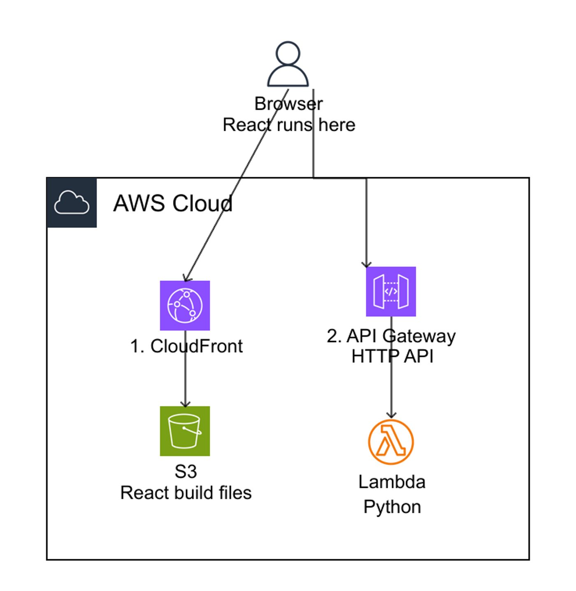

# wizway-hello-aws

繧ｦ繧｣繧ｺ繧ｦ繧ｧ繧､螳溽ｸｾ縺･縺上ｊ蜷代￠縺ｮ **Hello World** 繧ｵ繝ｳ繝励Ν縲・ 
**React + Python Lambda + API Gateway (HTTP API)** 縺ｮ縺ｿ・・ynamoDB 縺ｪ縺暦ｼ峨€・

繝・・繧ｿ縺梧ｮ九ｋ隕区悽・磯尅繝｡繝｢繝懊・繝会ｼ峨・蛻･繝ｪ繝昴ず繝医Μ:  
https://github.com/Kazuyuki-Hongo/wizway-memo-aws

## 讒区・

```
backend/          Python Lambda (GET /hello)
frontend/         React (Vite) 窶・Hello World 陦ｨ遉ｺ
template.yaml     SAM (HTTP API + S3 + CloudFront)
samconfig.toml    stack: wizway-hello-aws
.cursor/mcp.json  AWS Serverless MCP (profile=deploy)
```

### 讒区・蝗ｳ



1. 繝悶Λ繧ｦ繧ｶ縺・CloudFront 竊・S3 縺九ｉ逕ｻ髱｢繝輔ぃ繧､繝ｫ繧貞叙蠕・ 
2. 繝悶Λ繧ｦ繧ｶ蜀・〒 React 縺瑚ｵｷ蜍・ 
3. React 縺・API Gateway 縺ｮ `/hello` 繧貞他縺ｶ  
4. Lambda 縺・JSON 繧定ｿ斐☆  

## 蜍輔＞縺ｦ縺・ｋ逕ｻ髱｢・医ョ繝励Ο繧､蠕後↓霑ｽ險假ｼ・

繝・・繝ｭ繧､蠕後€＾utputs 縺ｮ `FrontendUrl` / `HelloEndpoint` 繧偵％縺薙↓譖ｸ縺上€・

## 蜑肴署

```powershell
aws sso login --profile deploy
aws sts get-caller-identity --profile deploy
```

Docker Desktop・・sam local` 逕ｨ・・

```powershell
winget install -e --id Docker.DockerDesktop
```

## 繝・・繝ｭ繧､

```powershell
sam build
sam deploy --profile deploy
```

`frontend/.env.production`:

```env
VITE_API_URL=https://xxxx.execute-api.ap-northeast-1.amazonaws.com/prod
```

```powershell
cd frontend
npm ci
npm run build
aws s3 sync dist/ s3://<FrontendBucketName>/ --delete --profile deploy
aws cloudfront create-invalidation --distribution-id <CloudFrontDistributionId> --paths "/*" --profile deploy
```

## 繝ｭ繝ｼ繧ｫ繝ｫ

```powershell
sam build
sam local start-api
```

蛻･繧ｿ繝ｼ繝溘リ繝ｫ:

```powershell
curl http://127.0.0.1:3000/hello
```

繝輔Ο繝ｳ繝・

```powershell
cd frontend
npm ci
# .env.local 縺ｫ VITE_API_URL=http://127.0.0.1:3000
npm run dev
```

## 髢｢騾｣

- 髮代Γ繝｢・・ynamoDB・・ https://github.com/Kazuyuki-Hongo/wizway-memo-aws
- 蟄ｦ鄙偵ヱ繝・け: https://github.com/Kazuyuki-Hongo/ai-utilization-pack ・・3.螳溽ｸｾ縺･縺上ｊ蜷代￠/04`・・
